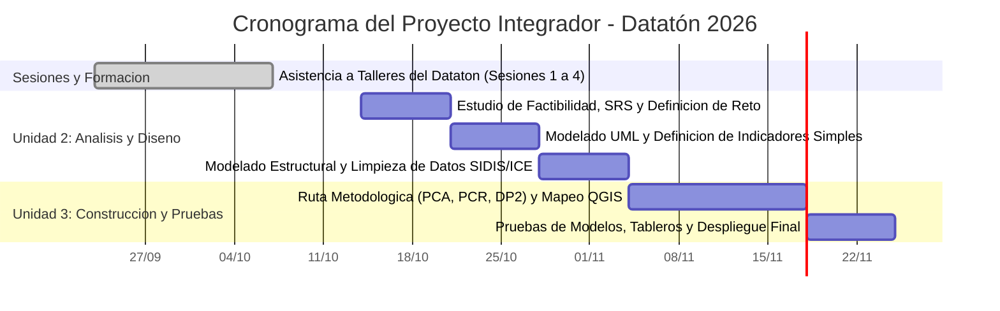

# Estudio de Factibilidad y Planificación del Proyecto
## 1. Análisis de Factibilidad Multidimensional
- **Factibilidad Técnica:** Evaluación de lenguajes y librerías de análisis de datos (Python con Pandas, NumPy, Scikit-learn), herramientas de software SIG para procesamiento e integración de datos espaciales (QGIS con complemento QuickMapServices), y fuentes de información gubernamentales/institucionales oficiales (bases del SIDIS / Dirección General de Información en Salud, INEGI y CONAPO).

## 2. Cronograma de Trabajo y Diagrama de Gantt (Sintaxis Mermaid)

## 3. Matriz de Asignación de Responsabilidades (RACI)
| Tarea / Entregable | Integrante 1 | Integrante 2 | Integrante 3 | Integrante 4 |
| :Jessica Paola Guerra Garnica | Hector Alejandro Hernandez Rodriguez | Jose Guadalupe Pichardo Cerritos | 
| Estudio de Factibilidad | A | R | C |
| Redacción SRS IEEE 830 | R | A | C |
| Diagramación UML | C | C | R |
| Diseño de Base de Datos | R | C | A |