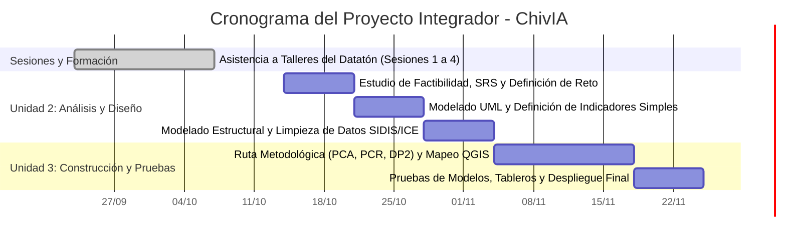
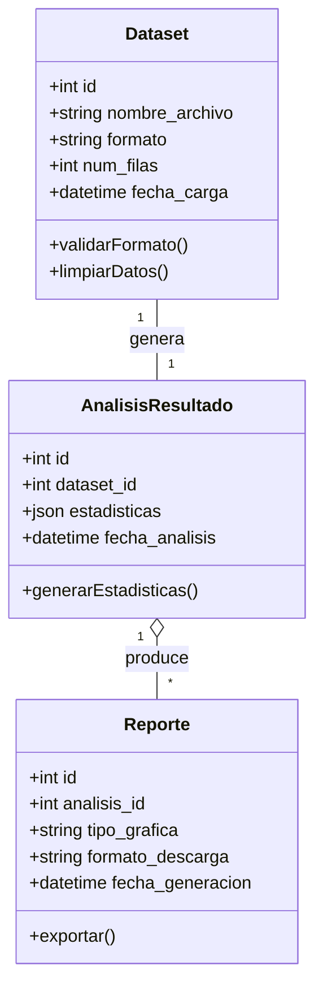
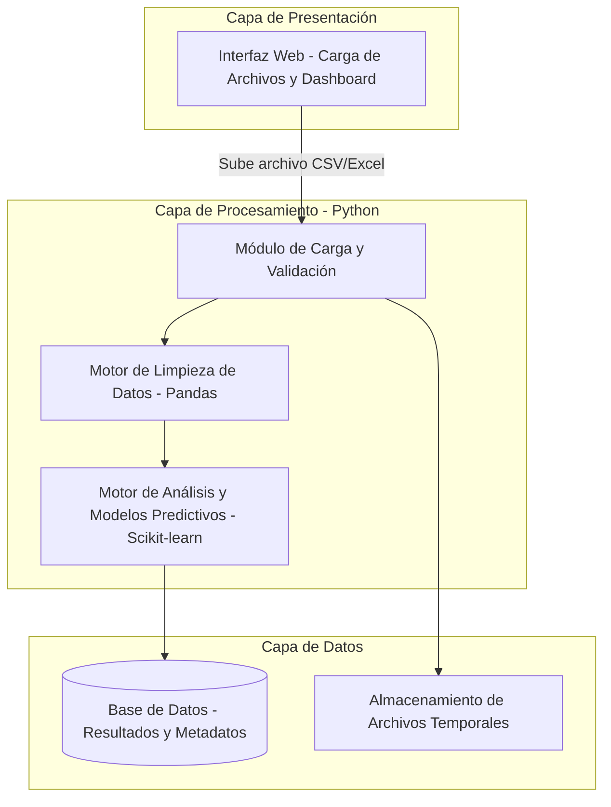

# Portafolio de Análisis y Diseño de Software — ChivIA (Unidad 2)

Documento maestro que integra los entregables de las Semanas 6 a 9: estudio de factibilidad, especificación de requisitos (IEEE 830), modelado UML y diseño de base de datos, y arquitectura e interfaces del sistema.

## Sección 1: Factibilidad y Planificación

### 1.1 Análisis de Factibilidad Multidimensional
- **Factibilidad Técnica:** Evaluación de lenguajes y librerías de análisis de datos (Python con Pandas, NumPy, Scikit-learn), herramientas de software SIG (QGIS con QuickMapServices), y fuentes oficiales (SIDIS, INEGI, CONAPO).

### 1.2 Cronograma de Trabajo (Diagrama de Gantt)


### 1.3 Matriz RACI
| Tarea / Entregable | Jessica Paola Guerra Garnica | Héctor Alejandro Hernández Rodríguez | Jose Guadalupe Pichardo Cerritos |
| :--- | :---: | :---: | :---: |
| Estudio de Factibilidad | A | R | C |
| Redacción SRS IEEE 830 | R | A | C |
| Diagramación UML | C | C | R |
| Diseño de Base de Datos | R | C | A |

## Sección 2: Especificación IEEE 830

### 2.1 Alcance del Sistema
El software tiene el objetivo de realizar análisis de datos mediante el envío de datasets en CSV o Excel, en el cual primero se realizará la limpieza del archivo para después realizar el análisis mediante gráficas y datos numéricos más importantes.

### 2.2 Requerimientos Funcionales (RF)
| Código | Nombre del Requisito | Descripción | Prioridad | Actor Principal |
| :--- | :--- | :--- | :---: | :--- |
| RF-01 | Ingreso de Datos | Espacio indicado para subir archivos CSV y Excel, con verificación para evitar archivos vacíos o formatos no permitidos. | Alta | Sistema |
| RF-02 | Procesamiento de Datos | El programa realizará un análisis de datos buscando la información más importante y destacada. | Alta | Sistema |
| RF-03 | Generación de Reportes | El programa generará gráficas y modelos predictivos descargables por el usuario. | Media | Sistema |

### 2.3 Requerimientos No Funcionales (RNF - ISO/IEC 25010)
- **RNF-01 (Rendimiento):** El tiempo de respuesta depende del tamaño del archivo; a mayor tamaño, mayor tiempo de respuesta.
- **RNF-02 (Seguridad):** Los datos serán cifrados desde que el usuario los envía hasta que llegan al sistema.
- **RNF-03 (Mantenibilidad):** El código será fácil de modificar según las necesidades que surjan.

### 2.4 Diagrama de Casos de Uso
```mermaid
usecaseDiagram
    actor Usuario
    package "Sistema de Análisis de Datos" {
        usecase "CU-01: Cargar Datos" as CU1
        usecase "CU-02: Consultar Dashboard" as CU2
        usecase "CU-03: Descargar Reportes" as CU3
    }
    Usuario --> CU1
    Usuario --> CU2
    Usuario --> CU3
```

## Sección 3: Modelado UML Completo

### 3.1 Diagrama de Clases


### 3.2 Diagrama de Componentes y Despliegue


## Sección 4: Diseño de Base de Datos

Script DDL completo disponible en [`database/schema.sql`](./database/schema.sql).

```sql
CREATE TABLE datasets (
    id SERIAL PRIMARY KEY,
    nombre_archivo VARCHAR(200) NOT NULL,
    formato VARCHAR(10) NOT NULL CHECK (formato IN ('csv','xlsx')),
    num_filas INT,
    fecha_carga TIMESTAMP DEFAULT CURRENT_TIMESTAMP
);

CREATE TABLE analisis_resultados (
    id SERIAL PRIMARY KEY,
    dataset_id INT NOT NULL REFERENCES datasets(id) ON DELETE CASCADE,
    estadisticas JSONB NOT NULL,
    fecha_analisis TIMESTAMP DEFAULT CURRENT_TIMESTAMP
);

CREATE TABLE reportes (
    id SERIAL PRIMARY KEY,
    analisis_id INT NOT NULL REFERENCES analisis_resultados(id) ON DELETE CASCADE,
    tipo_grafica VARCHAR(50) NOT NULL,
    formato_descarga VARCHAR(10) NOT NULL CHECK (formato_descarga IN ('pdf','png','xlsx')),
    fecha_generacion TIMESTAMP DEFAULT CURRENT_TIMESTAMP
);
```

## Sección 5: Arquitectura e Interfaces

### 5.1 Patrón Arquitectónico
Arquitectura en capas (Presentación, Lógica de Negocio, Datos), que aísla el motor de limpieza/análisis de la interfaz y de la persistencia, favoreciendo la mantenibilidad (RNF-03).

### 5.2 Wireframes Principales
- **Carga de archivo:** zona de arrastre/selección de CSV/Excel y estado de carga.
- **Dashboard de resultados:** gráficas y estadísticas clave, botón de descarga de reporte.
- **Historial de reportes:** lista de reportes generados con opción de descarga.

### 5.3 Endpoints REST
| Método | Endpoint | Descripción | Requisito |
| :--- | :--- | :--- | :--- |
| POST | `/api/v1/datasets` | Sube y valida un archivo CSV/Excel | RF-01 |
| GET | `/api/v1/datasets/{id}/analisis` | Ejecuta/consulta el análisis del dataset | RF-02 |
| GET | `/api/v1/reportes/{id}` | Obtiene el reporte generado | RF-03 |
| GET | `/api/v1/reportes/{id}/descargar` | Descarga el reporte en PDF/Excel | RF-03 |